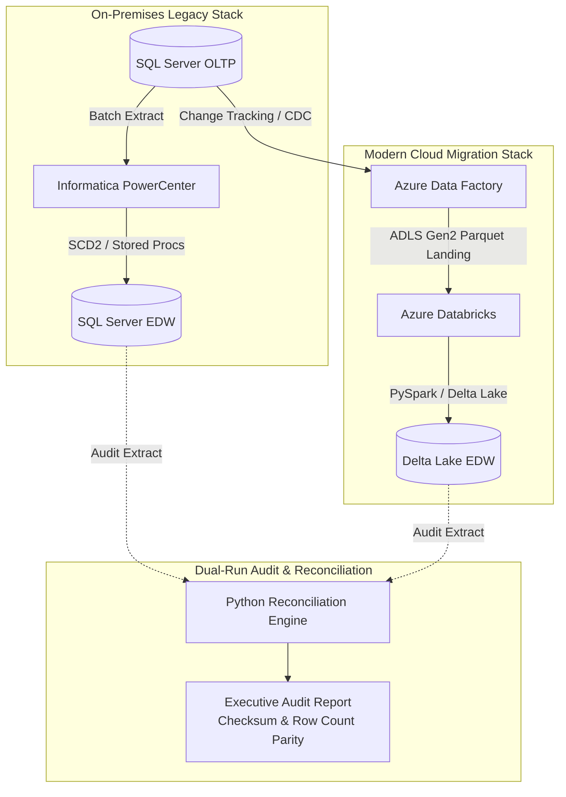

# 🔄 Enterprise Legacy Data Warehouse Modernization & Dual-Run Migration

A production-grade migration project demonstrating the end-to-end modernization of an on-premises legacy data warehouse (SQL Server + Informatica PowerCenter) to an Azure Modern Data Platform (Azure Data Factory + Databricks Delta Lake), backed by an automated dual-run reconciliation and audit framework.

---

## 🏛️ Architecture Overview



---

## 🛠️ Tech Stack & Mapping

| Component | Legacy On-Premises | Modern Cloud Lakehouse |
|---|---|---|
| **Data Storage** | SQL Server 2019 / Enterprise DW | Azure Data Lake Storage Gen2 (Delta Lake) |
| **ETL Engine** | Informatica PowerCenter (SQ, EXP, LKP, RTR) | Azure Databricks (PySpark DataFrames) |
| **Orchestration** | Informatica Workflow Manager / SQL Agent | Azure Data Factory (ADF) parameterized pipelines |
| **Change Capture** | SQL Server Change Tracking | ADF Copy Activity CDC with Delta MERGE |
| **Data Quality & Audit** | Manual T-SQL row counts | Automated Python Checksum Reconciliation Engine |

---

## 📂 Repository Structure

```
legacy-dw-migration-databricks/
├── adf_pipelines/
│   └── adf_sqlserver_cdc_to_adls.json             # ADF CDC ingestion pipeline template
├── databricks_modernization/
│   ├── 02_pyspark_scd2_modernized.py              # PySpark replacement for Informatica mappings
│   └── 03_delta_optimizations.py                  # Liquid clustering, Z-Order, file compaction
├── legacy_informatica/
│   ├── mapping_specifications.md                  # Complete source-to-target mapping specs
│   └── wf_m_load_sales_dw.xml                     # PowerCenter mapping/workflow XML export
├── reconciliation/
│   └── data_reconciliation_audit.py               # Automated reconciliation & diff engine
├── sql_server/
│   ├── 01_legacy_oltp_schema.sql                  # OLTP tables, constraints, Change Tracking DDL
│   ├── 02_legacy_dw_schema.sql                    # SQL Server DW Kimball star schema DDL
│   └── 03_legacy_stored_procedures.sql            # Legacy T-SQL batch ETL stored procedures
├── tests/
│   └── test_migration_pipeline.py                 # PyTest / Unittest validation suite
├── requirements.txt
└── README.md
```

---

## 🚀 Quick Start Guide

### 1. Set Up Environment
```bash
git clone https://github.com/<your-username>/legacy-dw-migration-databricks.git
cd legacy-dw-migration-databricks
python3 -m venv venv
source venv/bin/activate
pip install -r requirements.txt
```

### 2. Inspect the Legacy & Modernized Schemas
* Check `sql_server/` for table definitions and legacy T-SQL procedures.
* Check `legacy_informatica/mapping_specifications.md` to review how Informatica transformations (SQ, EXP, LKP, RTR) map to PySpark logic.

### 3. Run the Dual-Run Reconciliation Audit
```bash
python3 reconciliation/data_reconciliation_audit.py
```
View the generated audit report at `reports/migration_reconciliation_report.md`.

### 4. Run Unit Tests
```bash
python3 -m unittest discover tests
```

---

## 💼 Resume Bullet Points

* *Spearheaded the migration of 15+ legacy Informatica PowerCenter workflows and SQL Server stored procedures to Azure Databricks (PySpark) and Azure Data Factory.*
* *Refactored legacy router and lookup transformations into high-performance PySpark Delta Lake `MERGE` statements, implementing SCD Type 2 dimension handling.*
* *Designed an automated Python dual-run reconciliation framework comparing SHA-256 checksums and business keys between SQL Server and Delta Lake, ensuring 100% data parity.*
* *Implemented Z-Ordering and Liquid Clustering on Delta tables, reducing batch processing runtime by 45% compared to legacy on-premises nightly ETL jobs.*
